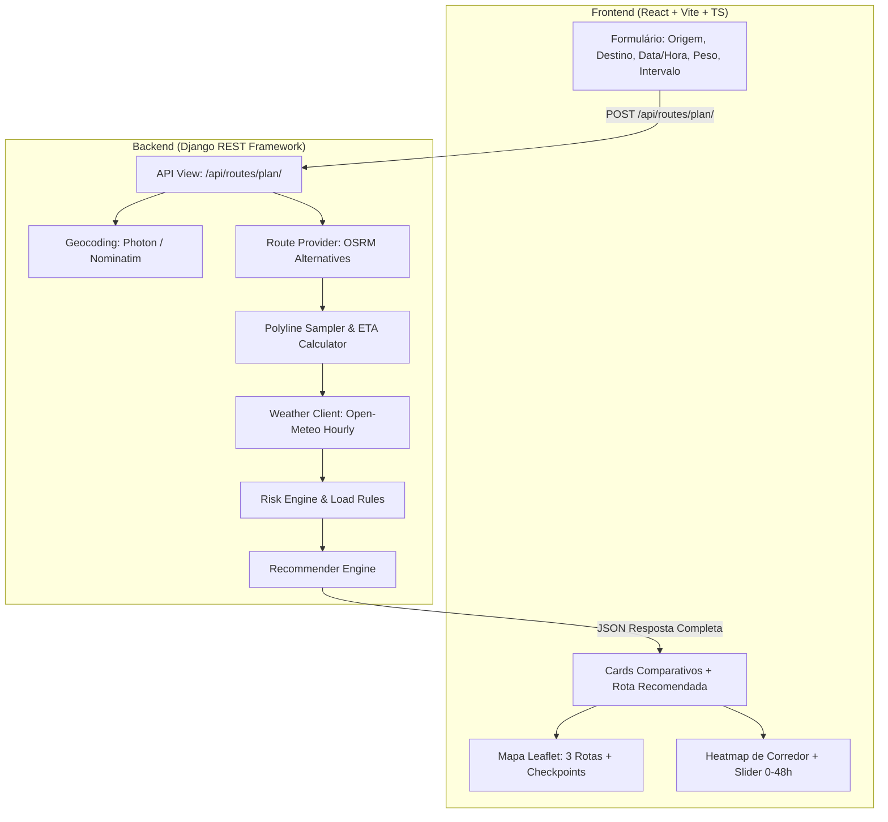

# Implementation Plan: Weather-Aware Truck Routing

> **Projeto:** Weather-Aware Truck Routing  
> **Stack:** Django (Django REST Framework) + React (Vite, TypeScript, Leaflet)  
> **Objetivo:** Ajudar motoristas de caminhão a escolher a rota mais segura com base no clima, peso da carga e tempo de viagem.

---

## 1. Critérios de Avaliação e Peso

| Peso | Pilar de Avaliação | Foco Principal |
| :---: | :--- | :--- |
| **40%** | **Rotas, Clima, Risco e Lógica de Recomendação** | Precisão matemática da matriz de risco, regras de carga, amostragem e desempate de rotas. |
| **40%** | **UI, Mapa e Heatmap (Fluidez e Performance)** | Renderização clara das 3 rotas, checkpoints informativos, heatmap de clima e slider 0–48h fluido. |
| **15%** | **Qualidade de Código** | Arquitetura limpa, tipagem estática, separação de responsabilidades e suite de testes unitários. |
| **5%** | **Documentação & Walkthrough** | README claro, instruções de deploy e vídeo no Loom (5 a 10 minutos). |

> *Diretriz do desafio:* **Priorizar correção e clareza sobre recursos extras.**

---

## 2. Arquitetura e Decisões Técnicas



### APIs Externas Selecionadas
1. **Geocodificação:** `Photon (OSM)` ou `Nominatim` (livre, sem chave, geocodificação direta para coordenadas `[lat, lon]`).
2. **Roteamento:** `OSRM (Open Source Routing Machine)` com suporte nativo a rotas alternativas (`alternatives=true` gerando até 3 opções).
3. **Previsão do Tempo:** `Open-Meteo API` (gratuita, sem necessidade de API key, dados horários de velocidade do vento em mph, precipitação em in/hr e neve em in/hr com previsão de 0 a 48h+).

---

## 3. Especificação das Regras de Negócio

### A. Matriz de Classificação de Risco por Checkpoint

| Condição | Low (1) | Moderate (2) | High (3) | Severe (4) | No Travel (5) |
| :--- | :---: | :---: | :---: | :---: | :---: |
| **Vento (mph)** | $< 25$ | $25 – 34$ | $35 – 44$ | $45 – 54$ | $\ge 55$ |
| **Chuva (in/hr)**| $< 0.10$ | $0.10 – 0.25$ | $0.25 – 0.50$ | $0.50 – 1.00$ | $> 1.00$ |
| **Neve (in/hr)** | $< 0.50$ | $0.50 – 1.00$ | $1.00 – 2.00$ | $2.00 – 3.00$ | $> 3.00$ |

### B. Regras de Carga (*Load Rules*)
O peso do caminhão afeta a estabilidade contra rajadas e ventos laterais. As regras substituem ou elevam o risco do vento:
1. $\text{Vento} \ge 55\text{ mph} \implies$ **No Travel** (para qualquer peso).
2. $\text{Vento} \in [45, 54]\text{ mph} \text{ E } \text{Peso} > 30.000\text{ lb} \implies$ **No Travel**.
3. $\text{Vento} \in [35, 44]\text{ mph} \text{ E } \text{Peso} > 40.000\text{ lb} \implies$ **Severe**.

*Nota:* O risco final de cada checkpoint é:  
$$\text{Risco}_{\text{checkpoint}} = \max(\text{Risco}_{\text{vento\_ajustado}}, \text{Risco}_{\text{chuva}}, \text{Risco}_{\text{neve}})$$

### C. Algoritmo de Recomendação da Rota
A rota recomendada é escolhida aplicando ordenação estrita pelos 4 critérios:
1. **Menor quantidade de milhas em Severe** (incluindo milhas em No Travel).
2. **Menor quantidade de milhas em High**.
3. **Menor risco médio** ($\text{Score Médio}$ da rota de 1.0 a 5.0).
4. **Menor tempo total de viagem** ($\text{Duração em segundos}$).

---

## 4. Detalhamento das Fases do Projeto

### **Fase 1: Setup do Repositório e Ambiente Base** *(Concluída)*
* [x] Inicialização do repositório Git com branch `main`.
* [x] Configuração de `.gitignore` para Python, Django, React, Vite e arquivos sensíveis.
* [x] Backend configurado: Django 5 + Django REST Framework + `django-cors-headers` + `requests` + `polyline`.
* [x] Estrutura modular em `backend/routing/services/` e `backend/routing/tests/`.
* [x] Frontend configurado: React 19 + TypeScript + Vite + Leaflet + Lucide Icons.
* [x] Documentação base [README.md](file:///home/doug/Estudos/spotter/README.md).

---

### **Fase 2: Serviços de Roteamento, Amostragem e Clima (Backend)**
* **2.1 Geocoding Service (`routing/services/geocoding.py`):**
  * Resolver endereços/cidades de origem e destino para pares `(lat, lon)`.
* **2.2 Route Provider Service (`routing/services/route_provider.py`):**
  * Consultar motor OSRM para recuperar 3 alternativas de rota com geometria decodificável, distância e duração.
* **2.3 Polyline Sampler & ETA Calculator (`routing/services/sampler.py`):**
  * Amostrar a rota a cada $N$ milhas (10, 25 ou 50 milhas selecionáveis pelo usuário).
  * Interpolação de pontos ao longo da linha.
  * Cálculo do ETA cumulativo em cada ponto: $\text{ETA}_i = \text{departure\_time} + \text{tempo\_acumulado}_i$.
* **2.4 Weather Client (`routing/services/weather_client.py`):**
  * Integração com Open-Meteo.
  * Consulta em lote para os checkpoints recuperando: `wind_speed_10m` (mph), `rain` (inch), `snowfall` (inch) para a hora exata do ETA.

---

### **Fase 3: Motor de Risco, Recomendação e Testes Unitários (Backend)**
* **3.1 Motor de Risco (`routing/services/risk_engine.py`):**
  * Classificação pura das métricas de clima segundo a tabela de limiares.
  * Aplicação das regras de carga (*load rules*).
  * Cálculo das milhas por categoria (`severe_miles`, `high_miles`, `moderate_miles`, `low_miles`, `no_travel_miles`).
  * Cálculo da pontuação média de risco.
* **3.2 Recommender Service (`routing/services/recommender.py`):**
  * Ordenação hierárquica das 3 rotas aplicando os 4 critérios estabelecidos.
  * Marcação da melhor opção com flag `is_recommended: true`.
* **3.3 Endpoint REST (`routing/views.py` e `routing/serializers.py`):**
  * Criação do endpoint `POST /api/routes/plan/` recebendo:
    ```json
    {
      "origin": "Chicago, IL",
      "destination": "Denver, CO",
      "departure_time": "2026-10-22T14:00:00Z",
      "load_weight": 42000,
      "sample_interval_miles": 25
    }
    ```
* **3.4 Suite de Testes Automatizados (`routing/tests/test_risk_engine.py`):**
  * Teste unitário para cada faixa da tabela de limiares (Low, Mod, High, Severe, No Travel).
  * Teste unitário para as 3 regras de carga (peso $\le 30k$, $30k < \text{peso} \le 40k$, $\text{peso} > 40k$).
  * Teste unitário para desempate do algoritmo de recomendação.

---

### **Fase 4: Frontend — Mapa Interativo, Rotas e Checkpoints**
* **4.1 Painel de Entrada de Dados:**
  * Formulário limpo com campos de Origem, Destino, Data/Hora de partida (padrão: "Agora"), Peso da Carga (lbs) e Seletor de Intervalo (10, 25, 50 mi).
* **4.2 Cards Comparativos:**
  * Apresentação das 3 rotas com destaque visual para a **Recomendada**.
  * Exibição das métricas-chave: Tempo de viagem, Milhas em risco Severo/Alto, Risco médio.
  * Clique no card para destacar a rota no mapa.
* **4.3 Mapa Interativo (Leaflet):**
  * Polylines coloridas diferenciando as 3 rotas (rota selecionada/recomendada em evidência).
  * Marcadores semafóricos para cada checkpoint:
    * 🟢 Verde: Low
    * 🟡 Amarelo: Moderate
    * 🟠 Laranja: High
    * 🔴 Vermelho: Severe
    * ⚫ Vinho/Preto: No Travel
  * Popup interativo nos checkpoints: ETA previsto, velocidade do vento, taxa de chuva/neve e aviso se a carga elevou o risco.

---

### **Fase 5: Weather Heatmap & Slider 0–48 Horas**
* **5.1 Corredor da Viagem:**
  * Delimitação da área de cobertura ao longo das rotas geradas.
  * Coleta dos dados horários de previsão para os pontos da malha do corredor.
* **5.2 Camada de Heatmap:**
  * Renderização de intensidade de mau tempo (precipitação e vento) sobre o mapa.
* **5.3 Forecast Slider (0 a 48 Horas):**
  * Barra de controle temporal deslizante de $+0\text{h}$ a $+48\text{h}$.
  * Atualização suave e reativa do heatmap para visualização de frentes climáticas em movimento.

---

### **Fase 6: Deploy, Documentação e Vídeo Loom**
* **6.1 Deploy da Aplicação:**
  * Backend publicado em serviço de nuvem (Render / Railway).
  * Frontend publicado na Vercel / Netlify.
  * Validação de CORS e variáveis de ambiente em produção.
* **6.2 Documentação Final:**
  * Atualização do README com links da aplicação online, instruções de execução e arquitetura.
* **6.3 Roteiro para o Vídeo Loom (5 a 10 min):**
  * **00:00 - 01:30:** Apresentação da arquitetura e decisões de projeto.
  * **01:30 - 04:30:** Demonstração prática da aplicação: cálculo das 3 rotas, análise dos checkpoints e rota recomendada.
  * **04:30 - 06:00:** Demonstração do heatmap e controle deslizante de 0–48h.
  * **06:00 - 08:00:** Prova das regras de carga (ex: comparando mesma rota com $25.000\text{ lb}$ vs $>40.000\text{ lb}$).
  * **08:00 - 10:00:** Visão geral do código limpo e execução dos testes unitários no terminal.
